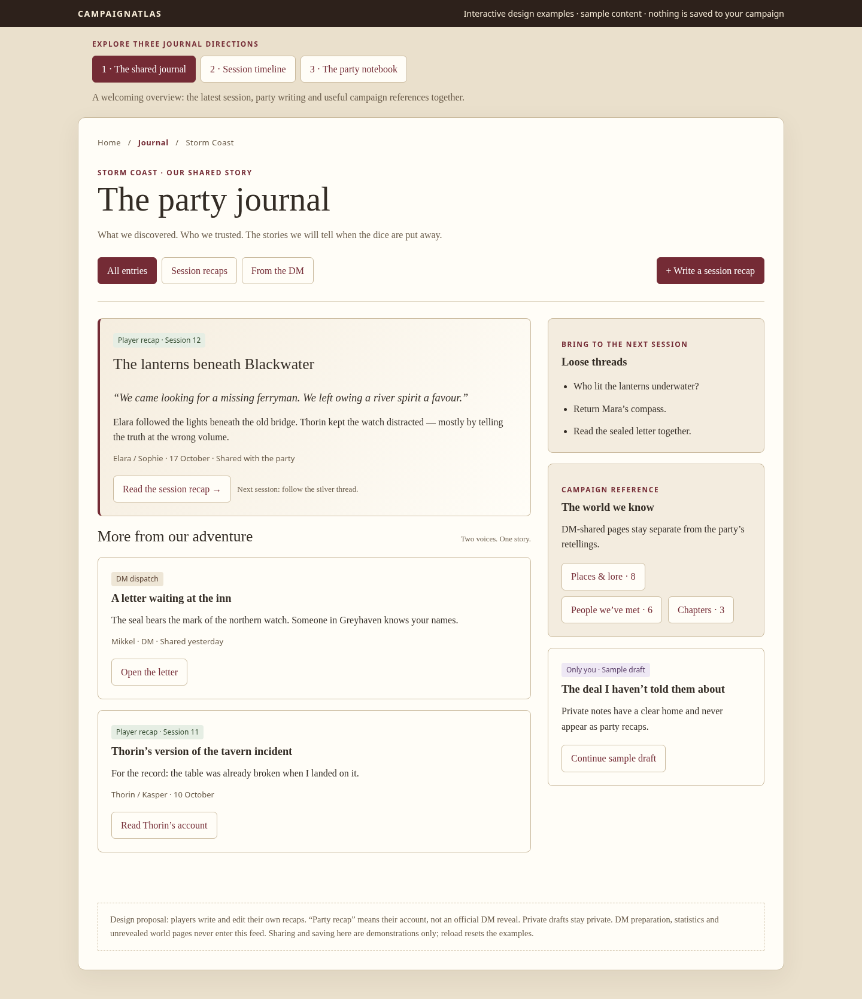
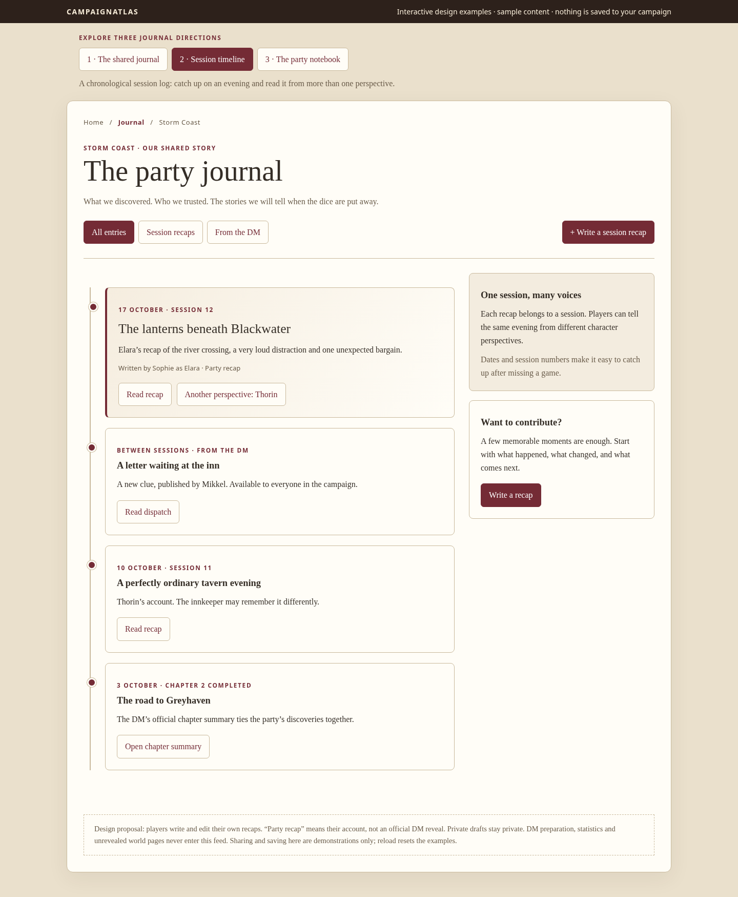
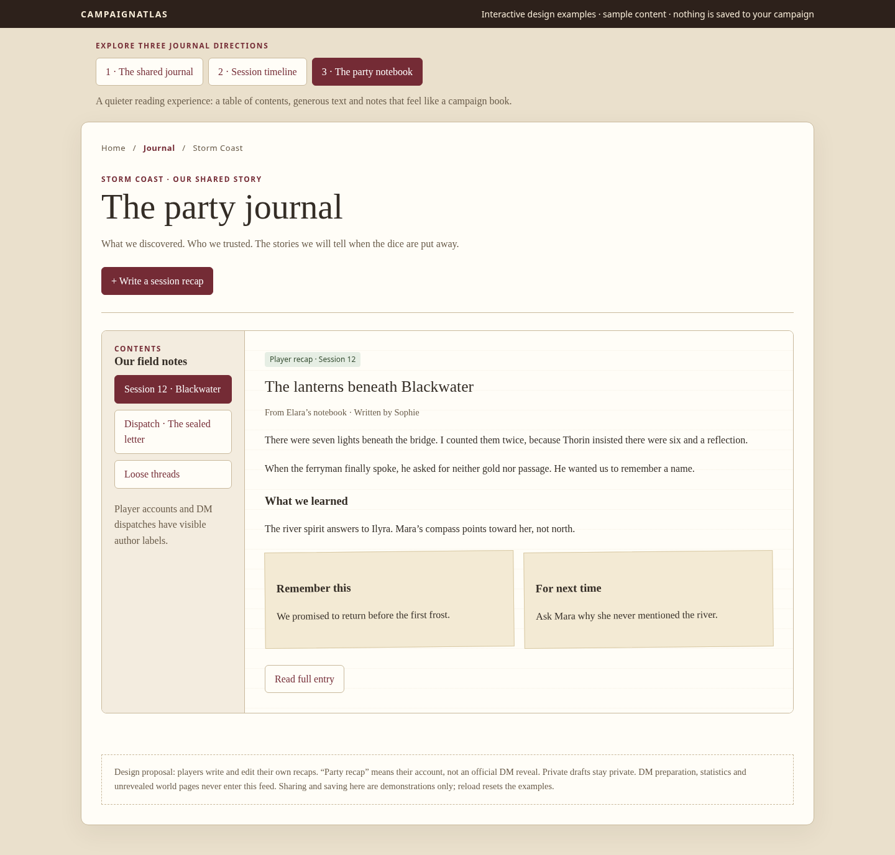

# Tre forslag til Journal

Åbn `journal-concepts.html` direkte i en browser. Filen er selvstændig og kræver hverken login, installation eller Firebase. Alle navne, opslag og sessions er eksempler. Genindlæsning nulstiller demonstrationen.

## 1. Fælles journaloverblik

En forside med seneste sessionsrecap, DM-opslag, løse tråde og genveje til offentliggjort lore, NPC’er og kapitler. Tydelige afsenderlabels adskiller spillerens fortælling fra DM’s officielle information. Filtre viser alle opslag, spillerrecaps eller DM-opslag.

## 2. Sessionstidslinje

En kronologisk læseliste gør det nemt at indhente en session, man missede. Flere spillere kan give hver sin version af samme aften. DM-opslag mellem sessionerne og officielle kapitelopsummeringer placeres i samme tidsforløb med deres egen afsenderlabel.

## 3. Gruppens notebook

En indholdsfortegnelse og en rolig læseside med god linjeafstand, små huskesedler og afsnit som “Hvad lærte vi?” og “Til næste gang?”. På mobil ligger indholdsfortegnelsen over teksten, så læsebredden bevares.

## Anbefalet kombination

Brug forslag 1 som Journal-forside, forslag 2 som en sessionsvisning og forslag 3 til at læse det enkelte opslag. Bevar eksisterende lore, NPC’er og kapitler som referenceafsnit frem for at blande deres redigeringsskærme ind i feedet.

Spillerrecaps bør have sessionsnummer, dato, titel, forfatter og eventuelt karakterperspektiv. Start med tre hjælpsomme spørgsmål: Hvad skete der? Hvad lærte vi? Hvad skal vi huske næste gang? Private kladder og opslag delt med kampagnen skal have tydelig forskellig status. Ingen ekstra godkendelsesrunde hos DM er indbygget i forslaget.

## Prøv i prototypen

- Skift mellem alle tre layoutforslag og filtrér opslag.
- Åbn recaps, DM-brev og referenceeksempler.
- Skift sider i notebookens indholdsfortegnelse.
- Skriv en recap, forhåndsvis den og behold en privat eksempelkladde.
- Vælg “Everyone in this campaign” for at føje en eksempelrecap til forsidens feed.

Kladder lever kun i den åbne sides hukommelse. Deling i prototypen ændrer kun eksempelvisningen. En senere implementering skal gemme forfatterbundne kladder/recaps og håndhæve kampagnemedlemskab samt forfatterrettigheder i Firestore-reglerne. Private DM-data må fortsat kun deles gennem de eksisterende bevidste publiceringshandlinger. Der er ikke ændret adgangsregler i dette forslag.

## Kontrol

`node tests/journal-concepts-browser.cjs` kontrollerer alle tre layouts ved 1440, 390 og 320 px, viewportbredde, axe WCAG A/AA gennem 2.2, filtre, indholdsfortegnelse, forhåndsvisning, privat/delt eksempeladfærd og fokusretur. Testet med Chromium. Ingen produktionsdata er læst eller ændret.
